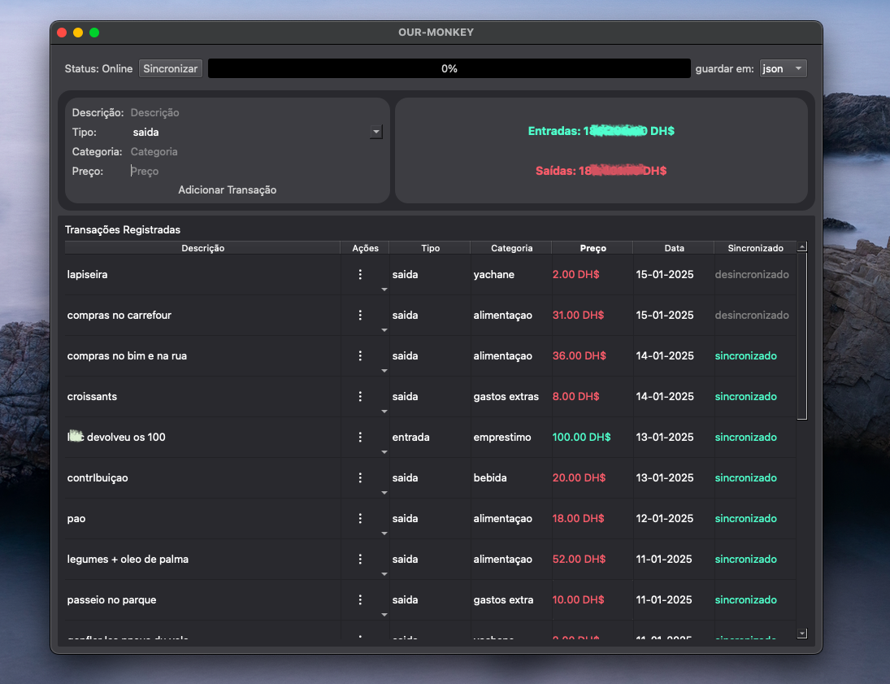

<p align="center"></p>


## Setup

Follow these steps to set up the project locally:

1. **Clone and Create a Virtual Environment** 
 
   Clone the project and use the following command to create a virtual environment:  
   ```bash
   pyenv install 3.13.5
   pyenv local 3.13.5
   python -m venv venv
   ```

2. **Activate the Virtual Environment**  
   - On **Linux/macOS**:  
     ```bash
     source env/bin/activate
     ```
   - On **Windows**:  
     ```bash
     .\env\Scripts\activate
     ```

3. **Install Required Dependencies**  
   Run the following command to install the dependencies listed in the `requirements.txt` file:  
   ```bash
   pip3 install git+https://github.com/moj-analytical-services/laurium.git
   pip3 install -r requirements.txt
   ```

4. **Generate the Requirements File (Optional)**  
   If you need to update the `requirements.txt` file after adding new dependencies:  
   ```bash
   pip3 freeze > requirements.txt
   ```
   
5. **system deps** 
   
   Make sure you have the following system dependencies installed:
   - On **Ubuntu/Debian**:  
     ....
     
   - On **macOS** (using Homebrew):  
     Download: Go to <a href="https://ffmpeg.martin-riedl.de">Martin Riedl’s FFmpeg builds</a>.

### Build the macOS installer

Build the installer on macOS with the same Python environment that contains the
application's runtime dependencies:

```bash
source env/bin/activate
python -m pip install -r requirements-build.txt
brew install create-dmg
./create_installer.sh
```

The script creates `dist/OurMoney.app` and `dist/OurMoney-Installer.dmg`.
The app icon, database, and assets are included in the bundle. On first launch,
the bundled database is copied to
`~/Library/Application Support/OurMoney/database/database.db`; subsequent
database changes are stored there so they persist across launches and app
updates. The app log is written to
`~/Library/Application Support/OurMoney/app.log`. Assets loaded by
application code should be resolved with `resource_path(...)` from
`utils.helppers`.

The voice transcription panel and its Whisper model load only when the Chatbot
section is opened. If the model cannot be loaded, the main app remains usable,
voice recording stays disabled, and the error is written to the app log.
Ollama is not required for startup.


### Objectivos

- [x] criar GUI para anotocoes dos gastos
      features 
      [x]
- [x] gerar pdf com analises dos dados
   
   features :
   
   - [x] table dos os gastos mensais por categoria
   - [x] table dos gastos recurrentes
   - [x] table dos gastos com previsões

- [ ] criar um executavel(pyinstaller)
- [ ] criar um installer setup wizard(inno setup)
- [ ] automatizar a criaçao do setup wizard com CI/CD a cada commit na branch main 

project structure:
```php
.
├── assets/
│    └── logo_icon.icns
├── database/
│    └── database.db
├── dto/
│    └── transaction_dto.py
├── entities/
│    └── transactions_entity.py
├── env/
├── repositories/
│    └── transactions_repository.py
├── services/
│    ├── delete_transation_service.py
│    ├── GenerateAnalyticsReportService.py
│    ├── export_csv_file_service.py
│    ├── export_json_file_service.py
│    ├── export_json_file_service.py
│    ├── import_json_file_service.py
│    ├── insert_transaction_service.py
│    ├── list_transaction_service.py
│    └── update_transaction_service.py
├── utils/
│    ├── helppers.py
│    ├── logger.py       
│    └── shared/
├── .gitignore
├── GUI.py
├── README.md
├── app.spec
├── controller.py
├── requirements.txt
└── main.py
```
about the new changes on build process:

The crash reports showed an uncaught `FileNotFoundError` because startup tried to run `ollama`, which wasn’t installed; the exception in a Qt worker thread caused a `SIGABRT`. The app also loaded PyTorch/Whisper before its main window appeared, delaying startup.

The changes now:
- Start without requiring Ollama; load the Chatbot and voice dependencies only when that section is opened.
- Catch and log voice-model, recording, and transcription failures instead of letting worker-thread exceptions abort the app.
- Write startup and error logs under `~/Library/Application Support/OurMoney/app.log`.
- Store the writable database in Application Support and bundle its initial copy, assets, and icon.
- Build a macOS onedir app and stage the DMG separately to avoid slow first-launch extraction and DMG overwrite collisions.

The refreshed `OurMoney-Installer.dmg` passed checksum and contents checks. The rebuilt app stayed running for 45 seconds in a clean-profile launch test and wrote its startup log. There are no OurMoney processes running now. The incidental `.DS_Store` change was restored.

The source changes are in `create_installer.sh`, `app.spec`, `GUI.py`, `bot_ui.py`, `main.py`, the database/resource/logging helpers, and `README.md`. Nothing has been committed. Note: this app is still ad-hoc signed, so macOS may still require **Control-click → Open**; normal distribution requires Developer ID signing and notarization.